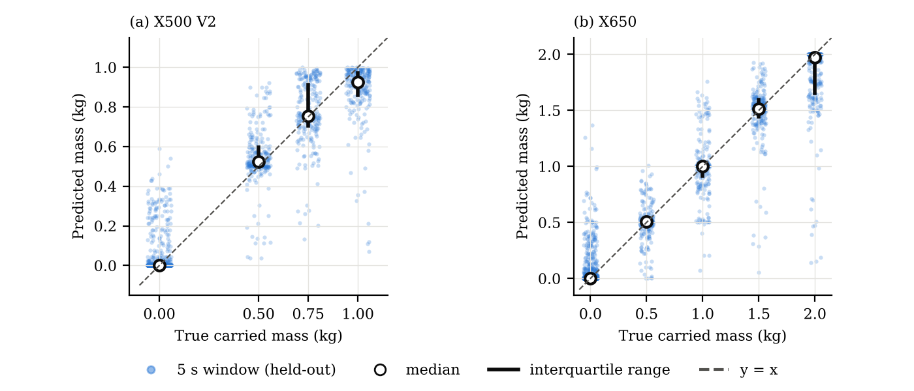
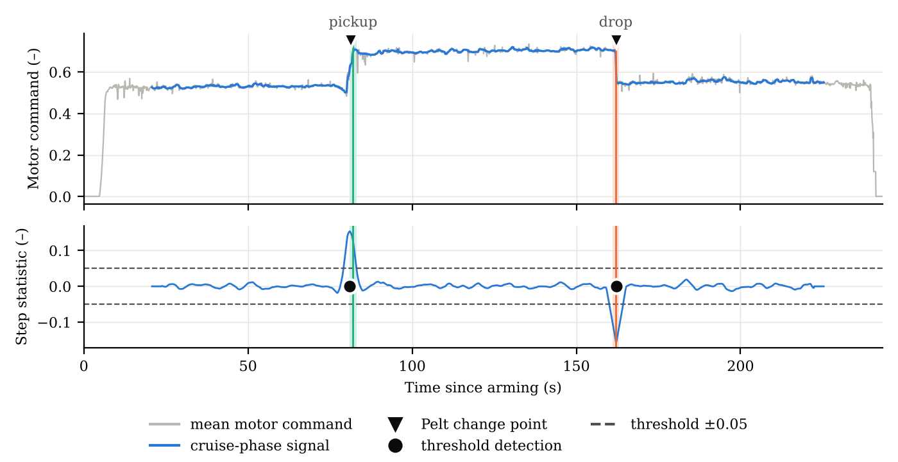

# DroneLog Devkit

Baseline scripts for the DroneLog dataset of PX4 flight logs (`.ulg`).
The devkit reads raw ULog files directly with `pyulog` and the dataset's
machine-readable metadata (`metadata/flights.csv`, `metadata/events.csv`).

**Version 1.1** of the devkit accompanies the revised paper *DroneLog: A
Real-Flight PX4 Telemetry Dataset for UAV Payload Transition Analysis and
Platform Identification* and the DroneLog v1.1 dataset. `python run_all.py
--data <dataset_root>` regenerates every result table of the paper.

## Abstract

DroneLog Devkit provides reproducible baselines for a UAV flight telemetry
dataset recorded as PX4 ULog files. The revised paper uses four of its tasks:
platform identification on the frame-size subset, payload state and
flight-level scenario recognition, payload-mass estimation, and pickup/drop
event detection. The baselines are intentionally simple, terminal-runnable
references. A navigation/odometry script (Task 4) is kept from v1.0 but is
not part of the revised paper.

## Contributions

- ULog-native loading utilities with topic discovery, regex-based field
  matching and caching.
- Baselines for platform identification, payload state, flight-level scenario,
  payload mass and pickup/drop detection, evaluated with repeated
  flight-grouped cross-validation and metadata-only controls.
- `run_all.py`, which regenerates every result table of the revised paper with
  fixed random seeds, plus per-flight predictions.
- Generated CSV tables, PNG figures, and a static devkit webpage in
  `site/index.html`.

## Install

Use Python 3.10 or newer (the paper's results were produced with Python 3.13 and the
pinned versions in `requirements.txt`). Create a virtual environment first:

```bash
python -m venv venv
```

If your system uses `python3` for Python 3, replace `python` with `python3` in
the setup commands.

Activate it using the command for your shell:

```bash
# macOS/Linux
source venv/bin/activate
```

```powershell
# Windows PowerShell
.\venv\Scripts\Activate.ps1
```

```bat
:: Windows Command Prompt
venv\Scripts\activate.bat
```

After activation, use `python` for the commands below. You can also run without
activation by replacing `python` with `venv/bin/python` on macOS/Linux or
`.\venv\Scripts\python.exe` on Windows.

Install dependencies:

```bash
python -m pip install -r requirements.txt
```

## Dataset Layout

Point `--data` at the root of the unpacked DroneLog v1.1 release:

```text
dataset_root/
  log/
    frame_size/
      250mm/ d250_1.ulg d250_2.ulg d250_3.ulg
      450mm/ ...  500mm/ ...  650mm/ ...  680mm/ ...
    payload/
      x500v2/
        0.5kg/ 1_scenario_t1.ulg ... 5_scenario_t3.ulg
        0.75kg/ ...  1kg/ ...
      x650/
        0.5kg/ ...  1kg/ ...  1.5kg/ ...  2kg/ ...
  csv/          same layout; one <log>_csvs/ folder of CSV files per log
  metadata/
    flights.csv one row per log (platform, mass, scenario, trial, pilot, date,
                duration, firmware, IMU rate, battery, GNSS quality, MD5, ...)
    events.csv  pickup/drop times in seconds after arming (log start)
```

`<s>_scenario_t<k>.ulg` is scenario `s` (1-5), trial `k` (1-3).
`1_scenario_t1.ulg` is the shared trial-1 no-payload flight of each platform,
so the same file appears in every mass folder of that platform. Labels,
grouping and event times are read from `metadata/`; flights with identical
MD5 checksums always share a cross-validation group.

## Run Commands

Regenerate every result of the revised paper:

```bash
python run_all.py --data <dataset_root> --out outputs
```

or run the tasks one by one:

```bash
python scripts/task1_frame_classification.py   --data <dataset_root> --out outputs
python scripts/task2_payload_classification.py --data <dataset_root> --out outputs
python scripts/task3_mass_regression.py        --data <dataset_root> --out outputs
python scripts/task5_event_detection.py        --data <dataset_root> --out outputs
```

The first run parses each log once and caches the signals in `.cache/`
(use `--no-cache` to force a fresh parse). Every script uses fixed random
seeds: repetition `r` of the cross-validation uses `random_state=r`.

Task 4 (navigation, v1.0) is not part of the revised paper and keeps its v1.0
interface:

```bash
python scripts/task4_navigation_odometry.py --data <dataset_root> --out outputs
```

## Outputs

All outputs are written under `outputs/` by default:

- `task1_frame_results.csv`: platform identification (Table 7): accuracy,
  macro-F1 (mean and s.d. over 10 repetitions), precision, recall, windows,
  groups, for 2/5/10 s windows plus the metadata-only and 200 Hz controls.
- `task1_per_flight.csv`: per-flight accuracy (Random Forest, 5 s, repetition 0).
- `task2_payload_results.csv`: payload state (Table 8), including the
  metadata-only, IMU-only, cross-session and per-platform rows.
- `task2_payload_per_flight.csv`: per-flight payload-state accuracy.
- `task2_scenario_results.csv`, `task2_scenario_confusion.csv`,
  `task2_scenario_per_flight.csv`: flight-level scenario recognition, its
  confusion matrix and the predicted scenario of every flight.
- `task3_mass_results.csv` (and `task3_mass_results_x500v2.csv`,
  `task3_mass_results_x650.csv`): mass estimation per platform (Table 9) with
  MAE per carried mass (Table 10), mean predictor, metadata-only control and
  cross-session split.
- `task3_mass_unseen.csv`: error on payload masses held out from training.
- `task3_mass_scatter.png` / `.pdf` (and per-platform PNGs): predicted versus
  true carried mass on held-out flights.
- `task5_event_results.csv`: pickup/drop detection (Table 11): precision,
  recall and F1 at tau = 1, 2, 5 s, false alarms per minute, median latency.
- `task5_detections_per_flight.csv`: every detection on every scored flight.
- `task5_events.png` / `.pdf`: detection example on one held-out flight.
- `task4_navigation_results.csv`, `task4_trajectory.png`: v1.0 navigation
  outputs (not regenerated by `run_all.py`).

## Results

All numbers below are produced by `python run_all.py --data <dataset_root>` on DroneLog v1.1
(mean ± s.d. over 10 repetitions of flight-grouped cross-validation unless stated otherwise).

### Task 1: Platform Identification (paper Table 7)

Five vehicles (250-680 mm), one per class. The metadata-only control shows that the vehicles can be
told apart from hardware and software signatures alone, so this is platform identification, not
evidence that frame geometry is learned.

| Window | Model | Accuracy | Macro-F1 |
|---|---|---:|---:|
| 2 s | Random Forest | 0.974 ± 0.002 | 0.974 ± 0.003 |
| 2 s | SVM | 0.926 ± 0.001 | 0.921 ± 0.001 |
| 2 s | KNN | 0.880 ± 0.004 | 0.877 ± 0.005 |
| 2 s | Logistic Regression | 0.896 ± 0.005 | 0.886 ± 0.006 |
| 5 s | Random Forest | 0.959 ± 0.005 | 0.958 ± 0.005 |
| 5 s | SVM | 0.927 ± 0.004 | 0.922 ± 0.003 |
| 5 s | KNN | 0.897 ± 0.004 | 0.892 ± 0.005 |
| 5 s | Logistic Regression | 0.919 ± 0.004 | 0.914 ± 0.005 |
| 10 s | Random Forest | 0.980 ± 0.009 | 0.978 ± 0.010 |
| 10 s | SVM | 0.932 ± 0.004 | 0.922 ± 0.004 |
| 10 s | KNN | 0.915 ± 0.006 | 0.912 ± 0.006 |
| 10 s | Logistic Regression | 0.973 ± 0.003 | 0.969 ± 0.003 |
| 5 s | Metadata only (RF) | 1.000 ± 0.000 | 1.000 ± 0.000 |
| 5 s | Random Forest, resampled to 200 Hz | 0.956 ± 0.006 | 0.955 ± 0.006 |

### Task 2: Payload State and Flight-Level Scenario (paper Table 8)

Payload state: is a payload attached in the window? Windows within 1 s of an event are excluded.

| Window | Model | Accuracy | Macro-F1 | Windows | Groups |
|---|---|---:|---:|---:|---:|
| 2 s | Random Forest | 0.957 ± 0.004 | 0.956 ± 0.004 | 9645 | 99 |
| 2 s | SVM | 0.957 ± 0.003 | 0.956 ± 0.003 | 9645 | 99 |
| 2 s | KNN | 0.940 ± 0.003 | 0.940 ± 0.003 | 9645 | 99 |
| 2 s | Logistic Regression | 0.896 ± 0.003 | 0.895 ± 0.003 | 9645 | 99 |
| 5 s | Random Forest | 0.966 ± 0.004 | 0.966 ± 0.004 | 3764 | 99 |
| 5 s | SVM | 0.965 ± 0.002 | 0.965 ± 0.002 | 3764 | 99 |
| 5 s | KNN | 0.950 ± 0.002 | 0.949 ± 0.002 | 3764 | 99 |
| 5 s | Logistic Regression | 0.931 ± 0.006 | 0.930 ± 0.006 | 3764 | 99 |
| 5 s | Metadata only (RF) | 0.633 ± 0.020 | 0.623 ± 0.020 | 3764 | 99 |
| 5 s | RF, IMU only | 0.943 ± 0.004 | 0.943 ± 0.004 | 3764 | 99 |
| 5 s | Random Forest, train t1 -> test t2/t3 | 0.955 | 0.954 | 2479 | 69 |
| 10 s | Random Forest | 0.973 ± 0.003 | 0.973 ± 0.003 | 1819 | 99 |
| 10 s | SVM | 0.970 ± 0.002 | 0.969 ± 0.002 | 1819 | 99 |
| 10 s | KNN | 0.959 ± 0.003 | 0.959 ± 0.003 | 1819 | 99 |
| 10 s | Logistic Regression | 0.961 ± 0.002 | 0.961 ± 0.002 | 1819 | 99 |

Flight-level scenario: which of the five scenarios was flown (one sample per flight).

| Model | Accuracy | Macro-F1 |
|---|---:|---:|
| Random Forest | 0.856 ± 0.014 | 0.855 ± 0.013 |
| SVM | 0.693 ± 0.013 | 0.691 ± 0.014 |
| KNN | 0.577 ± 0.031 | 0.583 ± 0.031 |
| Logistic Regression | 0.793 ± 0.036 | 0.797 ± 0.035 |
| Metadata only (RF) | 0.542 ± 0.043 | 0.534 ± 0.044 |
| Random Forest, train t1 -> test t2/t3 | 0.814 | 0.819 |

### Task 3: Payload-Mass Estimation (paper Tables 9-10)

Per platform; 5 s windows labelled with the mass carried at that time.

| Platform | Model | MAE (kg) | RMSE (kg) | R2 |
|---|---|---:|---:|---:|
| x500v2 | Random Forest | 0.069 ± 0.002 | 0.132 | 0.889 |
| x500v2 | Ridge | 0.130 ± 0.003 | 0.184 | 0.783 |
| x500v2 | Mean predictor | 0.368 | 0.394 | 0.000 |
| x500v2 | Metadata only (RF) | 0.364 ± 0.009 | 0.416 | -0.114 |
| x500v2 | Random Forest, train t1 -> test t2/t3 | 0.096 | 0.158 | 0.844 |
| x650 | Random Forest | 0.102 ± 0.005 | 0.225 | 0.908 |
| x650 | Ridge | 0.219 ± 0.003 | 0.326 | 0.808 |
| x650 | Mean predictor | 0.658 | 0.744 | 0.000 |
| x650 | Metadata only (RF) | 0.651 ± 0.024 | 0.807 | -0.177 |
| x650 | Random Forest, train t1 -> test t2/t3 | 0.149 | 0.265 | 0.868 |

MAE (kg) per carried mass, Random Forest:

| Platform | 0kg | 0.5kg | 0.75kg | 1kg | 1.5kg | 2kg |
|---|---:|---:|---:|---:|---:|---:|
| x500v2 | 0.030 | 0.098 | 0.122 | 0.143 | – | – |
| x650 | 0.049 | 0.113 | – | 0.174 | 0.166 | 0.186 |

Held-out (unseen) masses: Random Forest trained without any flight of that mass.

| Platform | Held-out mass (kg) | MAE on loaded windows (kg) | Mean prediction (kg) |
|---|---:|---:|---:|
| x500v2 | 0.75 | 0.200 | 0.847 |
| x650 | 1 | 0.491 | 0.794 |
| x650 | 1.5 | 0.281 | 1.539 |



### Task 5: Pickup/Drop Event Detection (paper Table 11)

Cruise-phase mean motor command; parameters chosen on training flights only; one-to-one matching;
scored on the 42 pickup/drop flights of trials 2-3 (56 events), tolerance tau = 2 s.

| Detector | Event | Precision | Recall | F1 | False alarms / min | Median abs. latency (s) |
|---|---|---:|---:|---:|---:|---:|
| Thresholded change-point | pickup | 0.93 | 0.96 | 0.95 | 0.016 | 0.64 |
| Thresholded change-point | drop | 0.84 | 0.96 | 0.90 | 0.041 | 0.34 |
| Pelt change-point | pickup | 0.93 | 0.90 | 0.91 | 0.016 | 0.65 |
| Pelt change-point | drop | 0.90 | 0.94 | 0.92 | 0.024 | 0.34 |



### Task 4: Navigation/Odometry (v1.0, not in the revised paper)

The navigation script and its outputs (`task4_navigation_results.csv`, `task4_trajectory.png`) are kept from
v1.0 for reference. The revised paper removed this task: the onboard GNSS is fused by the PX4 EKF, so it
is not an independent reference for evaluating the estimator.

## Limitations

- Each frame size and each payload platform is a single vehicle, so Task 1
  measures platform identification and cannot separate frame geometry from
  controller, IMU and firmware differences.
- Pickup and drop times were labelled from the QGroundControl flight timer
  (seconds after arming) and cross-checked against the flight log; their
  uncertainty is about ±1 s.
- `1_scenario_t1.ulg` is shared by all mass folders of a platform; identical
  files are always kept in the same cross-validation group.
- Payload flights were flown by two pilots at one site; wind and temperature
  were not recorded.

## ULog-Native Design

`dronelog/io.py` provides the loading layer:

- `list_topics(path)` parses the ULog and returns available topic names.
- `load_topic(path, topic, instance=0)` returns a `pandas.DataFrame` with the
  log's real fields and `timestamp` converted from microseconds to seconds.
- `find_fields(df, patterns)` discovers fields with case-insensitive regexes.
- `find_flights(root, subset)` recurses the dataset and returns parsed labels.

`sensor_combined` accelerometer and gyro fields are located by regex so the
scripts work across PX4 schema variations. Motor-command fields are discovered
from `actuator_motors` or `actuator_outputs`.

## Cache

Tasks 1, 2, 3 and 5 parse each log once and store the signals they use
(IMU, mean motor command, battery voltage) in:

```text
.cache/signals/<md5-of-log>.npz
```

Task 4 caches whole topics instead. The first cached topic load parses the
ULog and writes topic DataFrames to:

```text
.cache/<sha1-of-absolute-ulg-path>/<topic>__instanceN.parquet
```

Subsequent loads reuse parquet files if they are newer than the source ULog.
Use `--no-cache` to force a fresh parse. Clear all cached files with:

```bash
python -m dronelog.clear_cache
```

`pyarrow` is included in `requirements.txt` for parquet support. If parquet
support is unavailable, scripts still parse ULogs directly and warn that cache
writing is disabled.

## Frame Conventions

PX4 world frame is NED: North, East, Down. PX4 body frame is FRD: Forward,
Right, Down. Task 4 initializes attitude from `vehicle_attitude`, propagates
orientation from gyro increments with attitude correction from the logged
attitude topic, rotates body-frame specific force into NED, adds gravity
`[0, 0, 9.80665]` to recover linear acceleration, and integrates acceleration
to velocity and position. GPS is projected to local NED and used as navigation
truth; EKF local position is scored as a method.

## Webpage

A static devkit webpage is available at `https://azamatjon11.github.io/DroneLog/`. It summarizes the
five benchmark tasks, links the runnable commands, and embeds the generated
Task 3-5 figures.
